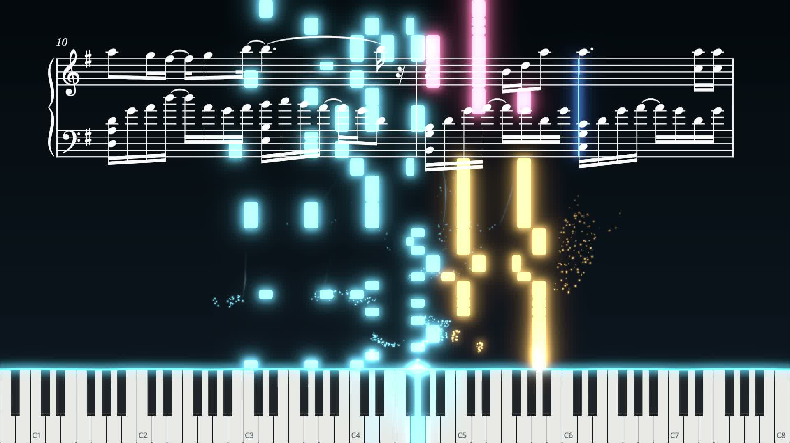

  [简体中文](README.md) | English

  

  # Trifle

  **Nothing special. Until it is.**

  An open-source MIDI piano visualizer — score sync · effects rendering · video export

  

## Features

- **Piano visualization**: notes strike the keyboard in sync; the contact line, keyboard lights, particles, glow and more are all independently adjustable
- **Score sync**: display sheet music with MuseScore 4, with cursor-line sync and a note-by-note typewriter reveal, even when the MIDI does not match the notation exactly
- **Universal MIDI**: open any `.mid` file directly for playback and visualization
- **Multiple backgrounds**: image, solid color, gradient and video
- **Audio support**: attach external audio with an offset, exported as an AAC track
- **Video export**: 1080p / 1440p / 4K · 24 / 30 / 60 FPS · H.264 / H.265, frame-by-frame rendering
- **Project management**: save all visual settings as project files, with automatic recovery
- **MIDI Output**: Works with the Windows 11 MIDI loopback feature to send the currently playing MIDI to a DAW or software instrument for real-time audio playback.

## Requirements

- Windows 10 / 11 (64-bit)

## Optional dependencies

- **FFmpeg** (video export, background videos): download a **full build** (must include `ffprobe.exe`) from the [official site](https://ffmpeg.org/download.html#build-windows), add it to `PATH`, or enter the full `ffmpeg.exe` path in the export window; background videos require `ffprobe.exe` in the same directory as ffmpeg
- **MuseScore 4** (score sync): detected automatically, or set manually in the score settings panel
- **Windows MIDI** (Win11 MIDI Loopback): Download and install `Windows.MIDI.Services.Tools` and `Windows.MIDI.Services.Transports` from the [official GitHub repository](https://github.com/microsoft/MIDI). Open the "MIDI Loopback Setup" tool; the default settings for the "+ New Loopback" option are sufficient. Enable MIDI output within the software and select "Default App Loopback (A)." In your DAW or standalone virtual instrument, set the input/monitoring to "Default App Loopback (B)." When the software plays MIDI, your DAW will receive the corresponding MIDI events. Note: This feature is currently intended only for previewing or use in conjunction with screen recording; audio generated via this function will not be included in the software's built-in video export feature.

## Feature coverage and known limitations

Score sync is built on MuseScore 4 exports and covers most conventional scores; the cursor and typewriter follow performance onsets and support basic section repeats, with the typewriter retyping from a repeat jump; expand complex repeats first, and verify unusual layouts or automatic row assignment against the actual score because they rely on heuristics.

## Build from source

1. Install [Godot 4.7.2 (.NET)](https://godotengine.org/download)
2. Open the project folder in Godot, or run `dotnet build Trifle.sln`

## Third-party notices

Licenses for the bundled third-party components (Godot Engine, DryWetMIDI, .NET Runtime) can be found in [licenses/THIRD-PARTY-LICENSES.txt](licenses/THIRD-PARTY-LICENSES.txt).

## License

Released under the [GNU AGPL-3.0](LICENSE).
